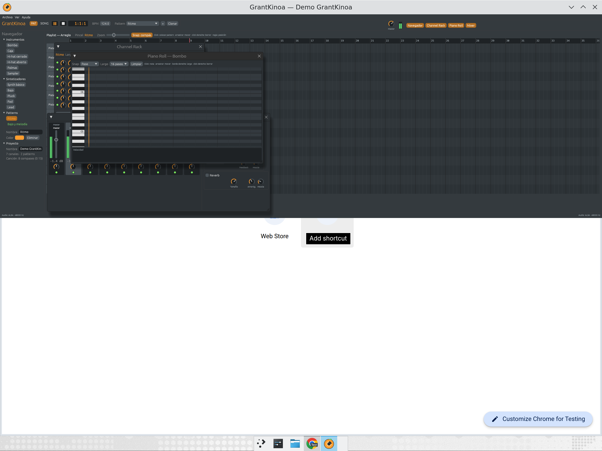

# GrantKinoa

DAW gratuito y de código abierto estilo FL Studio, hecho en Rust para Linux y Windows.



## Funciones

- **Channel Rack**: step sequencer con pintado por arrastre, volumen, paneo, mute y ruteo al mixer por canal.
- **Piano Roll**: notas con snap, mover/redimensionar, borrado con click derecho, carril de velocidad y teclado para escuchar.
- **Playlist**: arreglo de patterns en 16 pistas, mover clips, posicionar la reproducción desde la regla.
- **Modos Pattern / Song** como en FL Studio.
- **Instrumentos**: bombo, caja, hi-hat cerrado/abierto, palmas (sintetizados), synth sustractivo de 3 osciladores con ADSR y filtro resonante (presets Bajo, Pluck, Pad, Lead) y sampler de WAV.
- **Plugins de instrumento**: Kinoa 808 (glide y saturación), Kinoa Keys (piano eléctrico FM con trémolo), Kinoa Supersaw, Kinoa Strings, Kinoa Organ (drawbars + rotativo), Kinoa Guitar (modelado físico con distorsión) y percusión extra (rimshot, shaker, tom).
- **Mixer**: master + 8 inserts con volumen, paneo, mute, vúmetros y cadena de efectos: EQ de 3 bandas, compresor, sidechain (ducking) desde otro insert, saturador, bitcrusher, chorus, phaser, filtro, delay ping-pong, reverb y limitador.
- **Plantillas por género** (Archivo → Nuevo desde plantilla): hip hop, trap, R&B, pop, pop-rock, reggaetón y reggae, con kits, acordes, bajo y mezcla listos.
- **Swing** global y **teclado MIDI externo** (menú MIDI) para tocar el canal seleccionado.
- **Proyectos** `.gkp` (JSON) para guardar/abrir y **exportación a WAV** 44.1 kHz.

## Atajos

| Tecla | Acción |
|---|---|
| Espacio | Reproducir / pausar |
| L | Cambiar modo Pattern / Song |
| F5 / F6 / F7 / F9 | Navegador / Channel Rack / Piano Roll / Mixer |
| Ctrl+N / Ctrl+O / Ctrl+S | Nuevo / Abrir / Guardar |

En las perillas: arrastrar para cambiar, Shift para ajuste fino, doble click para valor por defecto.

## Descargas

Los binarios de Linux y Windows se generan en GitHub Actions; cada tag `v*` publica un release.

## Compilar

Requiere Rust estable (1.85+).

**Linux** (Debian/Ubuntu):

```sh
sudo apt install libasound2-dev libxkbcommon-dev libwayland-dev libgl1-mesa-dev pkg-config
cargo run --release
```

**Windows**: instalar Rust con [rustup](https://rustup.rs) y ejecutar `cargo run --release`.

**Windows desde Linux** (MinGW):

```sh
rustup target add x86_64-pc-windows-gnu
sudo apt install mingw-w64
cargo build --release --target x86_64-pc-windows-gnu
```

## Línea de comandos

```sh
grantkinoa proyecto.gkp                        # abre un proyecto
grantkinoa --render proyecto.gkp salida.wav    # renderiza sin abrir la ventana
grantkinoa --render --demo demo.wav            # renderiza la canción demo
```

## Licencia

MIT
